# Fraud Detection in Mobile-Money Transactions

**ML Zoomcamp 2026 — Midterm Project**

Predict whether a mobile-money transaction is fraudulent, using the PaySim
simulator dataset (6.36M transactions). Trained model is served over HTTP with
FastAPI and packaged with Docker.

> 🔗 **GitHub Repo:** [yazdanparasthesam/fraud-detection](https://github.com/yazdanparasthesam/fraud-detection)<br>
> 🌐 **Live Demo:** [paysim-fraud.streamlit.app](https://paysim-fraud.streamlit.app/)<br>
> 🎥 **Video Demo:** [Watch demo.mp4](https://github.com/yazdanparasthesam/fraud-detection/blob/main/demo.mp4)

<!--
  VIDEO: GitHub serves demo.mp4 as application/octet-stream, so some browsers
  download it instead of playing it inline. For guaranteed inline playback,
  drag demo.mp4 into any GitHub comment box, copy the resulting
  https://github.com/user-attachments/assets/<id> URL, and swap it in below.
-->
<video src="https://raw.githubusercontent.com/yazdanparasthesam/fraud-detection/main/demo.mp4" controls width="100%">
  Your browser does not support embedded videos.
</video>

<p align="center">
  
  
  
  
  
  
  
  
</p>

---

> ### ⚡ Quickstart (if you just unzipped this)
>
> The zip ships the **trained model**, so the service runs with no training and
> no dataset download:
>
> Requires **Python 3.12+** and [uv](https://docs.astral.sh/uv/):
>
> ```bash
> curl -LsSf https://astral.sh/uv/install.sh | sh     # Windows: see section 6
> ```
>
> Then:
>
> ```bash
> cd fraud-detection
> uv sync                                              # creates .venv from uv.lock
>
> uv run uvicorn predict:app --host 0.0.0.0 --port 9696   # API    -> localhost:9696/docs
> uv run streamlit run streamlit_app.py                   # Web UI -> localhost:8501
> ```
>
> `uv run` executes inside the project environment, so you never activate a
> venv. `outputs/fraud_report.xlsx` is already in the zip — open it to see the
> flagged transactions and their reason codes.
>
> **To retrain from scratch** you also need the 471 MB dataset (see
> [section 6](#6-how-to-run)):
>
> ```bash
> mkdir -p data
> curl -L -o data/paysim.csv https://huggingface.co/datasets/vitaliy-sharandin/synthetic-fraud-detection/resolve/main/PS_20174392719_1491204439457_log.csv
> uv run python train.py           # ~2-4 min, ~4 GB RAM
> ```

---

## 1. Problem description

Mobile-money networks move money for millions of people who have no bank
account. That makes them a target: the dominant fraud pattern is **account
takeover** — an attacker gains control of a customer's account and drains it,
typically by transferring the entire balance out and then cashing out.

The cost of getting this wrong is asymmetric and severe:

- **Miss a fraud (false negative)** and the customer loses their entire balance.
  Trust in the network collapses, and in most jurisdictions the operator eats the loss.
- **Block a legitimate transfer (false positive)** and you have locked a real
  customer out of their own money — angry support calls, regulatory complaints.

So this is **not** an accuracy problem. With a fraud rate of 0.13%, a model that
predicts "never fraud" is 99.87% accurate and completely worthless. The metrics
that matter are **PR-AUC** (does the model rank fraud above noise?) and the
precision/recall trade-off at the chosen threshold.

**How the solution is used:** the model sits in the authorisation path. Every
TRANSFER or CASH_OUT request is scored in real time; those above threshold are
held for manual review or blocked, everything else is approved instantly.

---

## 2. Dataset

PaySim — synthetic mobile-money transactions calibrated on one month of real
logs from a mobile-money service in an African country
(Lopez-Rojas, Elmir & Axelsson, 2016).

| | |
|---|---|
| Rows | 6,362,620 |
| Columns | 11 |
| Fraud | 8,213 (0.129%) |
| Size | 471 MB CSV |

**Download (no Kaggle account needed — public HuggingFace mirror):**

```bash
mkdir -p data
curl -L -o data/paysim.csv \
  https://huggingface.co/datasets/vitaliy-sharandin/synthetic-fraud-detection/resolve/main/PS_20174392719_1491204439457_log.csv
```

Verify — the SHA-256 must be
`16910f90577b0d981bf8ff289714510bb89bc71bff7d3f220f024e287e4eea6b`:

```bash
sha256sum data/paysim.csv
```

Columns: `step` (hour), `type`, `amount`, `nameOrig`, `oldbalanceOrg`,
`newbalanceOrig`, `nameDest`, `oldbalanceDest`, `newbalanceDest`, `isFraud`,
`isFlaggedFraud`.

---

## 3. Exploratory data analysis

Full analysis in `notebook.ipynb`. Highlights:

**Fraud is structurally confined to two transaction types.**

| Type | Transactions | Fraud | Rate |
|---|---:|---:|---:|
| PAYMENT | 2,151,495 | 0 | 0.0000% |
| CASH_OUT | 2,237,500 | 4,116 | 0.1840% |
| CASH_IN | 1,399,284 | 0 | 0.0000% |
| **TRANSFER** | **532,909** | **4,097** | **0.7688%** |
| DEBIT | 41,432 | 0 | 0.0000% |

PAYMENT, CASH_IN and DEBIT contain **exactly zero** fraud. The model therefore
only needs to score TRANSFER and CASH_OUT; every other type is auto-approved.
This cuts the modelling table to 2,770,409 rows with no loss of signal.

**Fraudulent amounts are ~6x larger.**

| | median | mean | p99 | max |
|---|---:|---:|---:|---:|
| Legitimate | 74,685 | 178,197 | 1,586,064 | 92,445,520 |
| Fraudulent | 441,423 | 1,467,967 | 10,000,000 | 10,000,000 |

Note the fraud maximum is *exactly* 10,000,000 — a hard cap in the simulator,
and a reminder this is synthetic data.

**The time dimension is not usable for splitting.** Fraud rate by period:

| Steps | Rows | Fraud rate |
|---|---:|---:|
| 1–60 | 454,210 | 0.157% |
| 61–120 | 11,617 | 5.940% |
| 601–660 | 11,039 | 6.196% |
| 721–744 | 272 | **100.000%** |

Transaction volume collapses after step ~560 and the final 24 hours are *entirely*
fraud. An out-of-time split would train on 0.23% fraud and test on 100% fraud —
meaningless. **A stratified random split is the correct choice here**, and the
project uses one (60/20/20, stratified on the target).

---

## 4. The leakage problem (and how it was avoided)

This was the most important finding of the project.

In PaySim, **transactions detected as fraud are cancelled**. That means the
post-transaction balance columns record the *outcome* of the decision being
modelled. On TRANSFER rows:

| Condition | Legitimate | Fraudulent |
|---|---:|---:|
| `newbalanceOrig == 0` | 95.97% | 96.12% |
| `oldbalanceOrg == amount` **and** `newbalanceOrig == 0` | **0.00%** | **96.00%** |

That second row is a near-perfect separator. A model given `newbalanceOrig`
would score ~100% and learn nothing that transfers to production, where the
balance *after* a transaction is not known until after you decide.

**Feature policy:**

| Allowed (known before authorisation) | Forbidden (post-transaction) |
|---|---|
| `step`, `type`, `amount` | `newbalanceOrig` |
| `oldbalanceOrg`, `oldbalanceDest` | `newbalanceDest` |
| `nameDest` prefix (merchant flag) | `isFlaggedFraud` |

From the allowed columns, 11 engineered features are derived: `hour_of_day`,
`day`, `log_amount`, `log_oldbalance_org`, `amount_to_balance`,
`balance_after_send`, `orig_balance_zero`, `dest_balance_zero`,
`dest_is_merchant`, `amount_zero`.

---

## 5. Model selection

Trained on 1,662,245 rows, tuned on 554,082 validation rows, evaluated once on a
held-out 554,082-row test set. **PR-AUC is the selection metric** — with 0.3%
positives, ROC-AUC is optimistic and accuracy is meaningless.

| Model | Configuration | PR-AUC | ROC-AUC |
|---|---|---:|---:|
| Logistic Regression | C=0.01 | 0.2953 | 0.9681 |
| Logistic Regression | C=0.1 | 0.2953 | 0.9681 |
| Logistic Regression | C=1.0 | 0.2744 | 0.9650 |
| Logistic Regression | C=10 | 0.2954 | 0.9681 |
| **Decision Tree** | **max_depth=4** | **0.9950** | **0.9991** |
| Decision Tree | max_depth=6 | 0.9937 | 0.9976 |
| Decision Tree | max_depth=8 | 0.9915 | 0.9970 |
| Decision Tree | max_depth=10 | 0.9909 | 0.9970 |
| Random Forest | n=50, depth=10 | 0.9947 | 0.9977 |
| Random Forest | n=50, depth=15 | 0.9945 | 0.9973 |
| Random Forest | n=100, depth=10 | 0.9946 | 0.9985 |
| XGBoost | eta=0.1, depth=6 | 0.9851 | 0.9978 |
| XGBoost | eta=0.1, depth=8 | 0.9853 | 0.9981 |
| XGBoost | eta=0.3, depth=6 | 0.7109 | 0.9218 |
| XGBoost | eta=0.3, depth=8 | 0.9070 | 0.9851 |

**Selected: `DecisionTreeClassifier(max_depth=4, class_weight="balanced")`.**

Three findings worth calling out:

1. **Linear models fail badly** (PR-AUC 0.30 vs 0.99). The fraud signature is a
   *rule* — "the transfer empties the account" — which is a step function no
   linear combination of features can express. `class_weight='balanced'` keeps
   the model from ignoring the minority class, but the fundamental problem is
   that the decision boundary is not a hyperplane.

2. **A depth-4 tree beats both ensembles.** Ensembles win when the signal is
   many weak, interacting patterns. Here the signal is one crisp rule, so extra
   capacity only adds variance. Random Forest (0.9946) and XGBoost (0.9853)
   both land *below* the single shallow tree.

3. **XGBoost's eta matters enormously** — 0.1 gives 0.9851, 0.3 gives 0.7109.
   At eta=0.3 the booster overshoots on a problem this imbalanced.

### Final model on the held-out test set

```
PR-AUC  0.9968
ROC-AUC 0.9992

F1-optimal threshold 0.9994   (precision 0.996, recall 0.998)

confusion matrix          pred legit   pred fraud
  true legit                  552,433            7
  true fraud                        4        1,638
```

Out of 554,082 held-out transactions: **7 false positives and 4 false
negatives**. The tree explains itself completely:

```
|--- balance_after_send <= -0.56
|   ...
|--- balance_after_send >  -0.56
|   |--- balance_after_send <= 0.37   -> FRAUD      <- account drained to ~zero
|   |--- balance_after_send >  0.37   -> legitimate
```

Feature importance: `balance_after_send` **0.9681**, `log_amount` 0.0278,
everything else below 0.003. The model is, in essence, one interpretable rule.

---

## 5b. Unsupervised anomaly detection (Isolation Forest)

The decision tree is *supervised*: it can only recognise fraud that looks like
fraud it already saw. A fraud-control system also needs an unsupervised
detector for patterns nobody has labelled yet. `score_and_export.py`
therefore trains and scores an **Isolation Forest** on exactly the same
16-feature matrix — with one crucial difference: **it never sees the
`isFraud` label.**

```bash
uv run python score_and_export.py # ~90 s, writes outputs/fraud_report.xlsx
```

`IsolationForest(n_estimators=100, contamination=0.01, random_state=42)`,
fitted on all 2,770,409 rows and scored on all of them.

### Supervised vs unsupervised — the honest comparison

| model | labels | flagged | true pos | false pos | precision | recall | PR-AUC | ROC-AUC |
|---|---|---:|---:|---:|---:|---:|---:|---:|
| Decision Tree (supervised) | yes | 8,215 | 8,182 | 33 | **0.996** | **0.996** | **0.9976** | **0.9996** |
| Isolation Forest (unsupervised) | **no** | 27,705 | 2,155 | 25,550 | 0.078 | 0.262 | 0.0474 | 0.9101 |

Tree metrics above are over all rows (including training data); the held-out
test-set PR-AUC is 0.9968.

**This gap is the finding, not a defect.** Read it carefully:

- The Isolation Forest isolates transactions that are *statistically rare*, but
  in PaySim most rare transactions are legitimate. At the 1% contamination
  setting it produces **12x more false positives** than the tree for **a
  quarter of the recall**.
- Its ROC-AUC of 0.910 is respectable — it has genuinely learned *something*
  about the fraud distribution without ever being shown a label. But ROC-AUC
  flatters imbalanced problems; PR-AUC of 0.047 against a 0.30% base rate is
  close to useless for triage.
- Conclusion: **unsupervised detection is not a substitute for labelled data
  when labels exist.** Its value is as a *second opinion* — surfacing unusual
  transactions that the supervised model confidently clears, which is how an
  analyst finds the next fraud pattern.

### Where the two models disagree

| verdict | count | what it means |
|---|---:|---|
| both flag | 2,169 | highest-confidence cases — review first |
| tree only | 6,046 | known fraud pattern, statistically unremarkable |
| forest only | 25,536 | statistically weird, cleared by the tree — mostly noise, but this is where novel fraud would appear |
| neither | — | 30 confirmed frauds were missed by **both** detectors |

Those 30 doubly-missed frauds are in the report's *Confirmed Fraud* sheet with
`detection = "neither"` — the honest floor of what this system cannot catch.

---

## 5c. The Excel report (`outputs/fraud_report.xlsx`)

`uv run python score_and_export.py` writes a 10 MB workbook with every
suspected transaction and **the reason it was flagged**.

| sheet | rows | contents |
|---|---:|---|
| Summary | 25 | run statistics for both detectors |
| Model Comparison | 2 | the supervised/unsupervised table above |
| **Suspected Fraud** | **33,751** | every transaction flagged by *either* detector, with reasons |
| Confirmed Fraud | 8,213 | every real fraud, including the 30 both models missed |
| Disagreements | 31,582 | the two detectors voted differently |
| Scored Sample | 25,000 | random sample of all scored rows for sanity-checking |
| Field Reference | 26 | what every column and flag means |

Excel caps a sheet at 1,048,576 rows, so the workbook exports the **flagged
subset** rather than all 2,770,409 rows.

### How each row explains itself

Every flagged row carries two independent reason code sets, only filled in for
the detector that actually fired:

**Decision tree** — the deployed model is only 4 levels deep, so each
prediction is traceable to an exact rule.

| column | meaning |
|---|---|
| `dt_rule` | the full decision path, e.g. `balance_after_send > -0.56 AND balance_after_send <= 0.37` |
| `dt_trigger_field` | the field that actually pinned this row down |
| `dt_trigger_rarity_pct` | % of all transactions satisfying that condition — lower = rarer |
| `dt_reason` | the same thing in plain English |

`dt_trigger_field` is chosen by **rarity, not by global importance**. Global
importance always names the root split (`balance_after_send`), which every
single row shares — useless as an explanation. Instead, for each leaf we
measure what fraction of the whole population satisfies each condition on its
path, and report the **rarest** one: the constraint that made this particular
transaction unusual. That yields two distinct triggers in practice:

| trigger field | flagged | rarity | fraud rate | plain English |
|---|---:|---:|---:|---|
| `balance_after_send` | 8,037 | 10.2% | **99.96%** | sender keeps money behind (balance after sending > -0.56) |
| `log_amount` | 178 | 4.8% | 83.1% | large amount (log1p > 13.80) |

**Isolation Forest** — |`if_top_field`| the field furthest from the population
median, and `if_reason` names the two most extreme fields as robust z-scores
against the interquartile range, e.g.
`unusually HIGH amount_to_balance (z=9.6); unusually LOW balance_after_send (z=6.0)`.
(Median/IQR rather than mean/stddev because these distributions are extremely
skewed.)

---

## 6. How to run

### Install

The project uses **[uv](https://docs.astral.sh/uv/)** for environment and
dependency management. Python **3.12+** is required (xgboost 3.4.1 needs it).

```bash
# macOS / Linux
curl -LsSf https://astral.sh/uv/install.sh | sh

# Windows (PowerShell)
powershell -ExecutionPolicy ByPass -c "irm https://astral.sh/uv/install.ps1 | iex"

# alternative, if you already have Python
pip install uv
```

Then, from the project root:

```bash
uv sync
```

`uv sync` creates `.venv` and installs the exact versions recorded in
`uv.lock` — the same ones that produced the metrics in this README. Every
command below is run with `uv run`, which uses that environment automatically.

> **Why both `uv.lock` and `requirements.txt`?** `pyproject.toml` is the source
> of truth; `uv.lock` freezes the complete transitive tree (53 packages) for
> reproducible rebuilds; `requirements.txt` is kept for pip users and for the
> Docker image.

Prefer plain pip? That works too, just without the lockfile:

```bash
python -m venv .venv
source .venv/bin/activate          # Windows: .venv\Scripts\activate
pip install -r requirements.txt
```

### Get the data

```bash
mkdir -p data
curl -L -o data/paysim.csv \
  https://huggingface.co/datasets/vitaliy-sharandin/synthetic-fraud-detection/resolve/main/PS_20174392719_1491204439457_log.csv
```

### Train

```bash
uv run python train.py
```

Streams the 471 MB CSV in blocks (peak memory ~350 MB), keeps TRANSFER +
CASH_OUT, builds the leak-free features, trains the final model, prints the test
metrics and the learned rules, and writes `models/fraud_model.bin`.

The first run also writes `data/paysim_model.parquet` — a compact cache of the
prepared table, so re-runs skip the CSV parse. Set `PAYSIM_REBUILD=1` to force a
rebuild. On machines with less than 4 GB RAM, use `PAYSIM_FIT_SPLIT=train`.

### Run the notebook

The notebook must run in the project environment, otherwise you get a different
pyarrow than the one pinned in `uv.lock` and hit errors like
`module 'pyarrow.compute' has no attribute ...`:

```bash
uv run --with jupyter jupyter lab      # opens notebook.ipynb
```

Prefer Jupyter installed permanently? `uv add --dev jupyterlab`, then
`uv run jupyter lab`.

### Serve

```bash
uvicorn predict:app --host 0.0.0.0 --port 9696
```

### Call it

```bash
curl -X POST http://localhost:9696/predict \
  -H 'Content-Type: application/json' \
  -d '{"step":300,"type":"TRANSFER","amount":181.0,
       "oldbalanceOrg":181.0,"oldbalanceDest":0.0,"nameDest":"C1234567890"}'
```

```json
{"fraud_probability": 1.0, "is_fraud": true,
 "decision": "block", "risk_band": "critical", "threshold": 0.9993685343665771}
```

`GET /health` returns the model checksum and test metrics, so you can verify
which model is actually deployed.

Interactive docs are served automatically at **http://localhost:9696/docs**.

### Web UI

A Streamlit front end is included. It holds **no model of its own** — it calls
the FastAPI service over HTTP, so the UI and the inference service can be
scaled and redeployed independently.

```bash
uv run streamlit run streamlit_app.py --server.port 8501
```

Then open **http://localhost:8501**.

The UI has two tabs:

**🔍 Single transaction** — four one-click examples (fraudulent transfer,
legitimate transfer, fraudulent cash-out, auto-approved payment), live backend
status with the model's test metrics, and an explanation panel showing
`balance_after_send = oldbalanceOrg − amount` — the feature carrying 0.968 of
the model's importance — so you can see *why* a transaction scored the way it
did.

**📂 Batch file** — upload a **CSV or Excel** file of transactions and the
service scores **every row**, returning the fraud cases it found with a reason
for each one. Details below.

> The UI calls the API from Python (server-side), so `localhost:9696` is the
> correct address even when both run inside containers on the same host.

To run both at once:

```bash
uvicorn predict:app --host 0.0.0.0 --port 9696 &
uv run streamlit run streamlit_app.py --server.port 8501
```

Set `API_URL` to point the UI at a backend on another host or port.

---

## 6b. Scoring an uploaded file (CSV / Excel)

The UI's **📂 Batch file** tab uploads a file to the service, which scores every
row and returns the suspected fraud with an explanation per row. [`sample_transactions.csv`](sample_transactions.csv)
(200 rows, 40 of them fraud) ships with the project so you can try it instantly.

### What the upload needs

Only the **pre-transaction** columns. Anything else is ignored:

| field | required | notes |
|---|---|---|
| `amount` | ✅ | transaction size |
| `oldbalanceOrg` | ✅ | sender balance **before** |
| `oldbalanceDest` | optional | defaults to 0 |
| `type` | optional | defaults to TRANSFER |
| `step` | optional | defaults to 1 |
| `nameDest` | optional | `M…` ids are merchants; defaults to non-merchant |
| `isFraud` | optional | if present you get precision / recall / PR-AUC back |

Column names are matched case- and separator-insensitively, so
`Old Balance Org`, `oldbalance_org` and `oldbalanceOrg` all work, and common
synonyms are recognised (`Sender Balance`, `Amount`, `Transaction Type`,
`Recipient`, …). Anything not matched can be **remapped by hand** in the UI's
"Preview & column mapping" panel before scoring.

> `newbalanceOrig` / `newbalanceDest` are ignored **on purpose**, even if your
> file has them. They record the outcome of the decision being modelled and
> would leak the label (see [section 4](#4-the-leakage-problem-and-how-it-was-avoided)).

### What you get back

* **Summary** — rows scored, fraud found, flagged rate, how many were
  auto-approved because their type carries no fraud.
* **Evaluation** — *only if your file has a label column*: precision, recall,
  false positives/negatives, PR-AUC and ROC-AUC measured on your own data.
* **Per-row explanation** —
  * `why_flagged` — the condition that pinned the row down, in plain English
    (e.g. *"sender's balance is emptied by the transfer"*).
  * `decision_rule` — the full path through the tree
    (e.g. `balance_after_send > -0.56 AND balance_after_send <= 0.37`).
* **Downloads** — the report as CSV or a two-sheet Excel workbook (Summary +
  Results).

### Calling it directly

```bash
curl -X POST "http://localhost:9696/score-file?limit=50000" \
     -F "file=@sample_transactions.csv"
```

Add `include_legit=true` to also return the rows that were cleared. The
endpoint caps a single upload at **500,000 rows** and returns at most `limit`
rows (flagged first, highest risk at the top).

Verified on the bundled sample file: **precision 1.000, recall 0.950,
PR-AUC 0.980** — 38 of the 40 real frauds found, zero false positives.

---

## 7. Run with Docker

```bash
# Behind a proxy (corporate / university networks)? Pass it in. HTTP_PROXY,
# HTTPS_PROXY and NO_PROXY are Docker's PREDEFINED build args, so no Dockerfile
# change is needed and nothing is baked into the final image.
docker build \
  --network=host \
  --build-arg HTTP_PROXY="$HTTP_PROXY" \
  --build-arg HTTPS_PROXY="$HTTPS_PROXY" \
  --build-arg http_proxy="$http_proxy" \
  --build-arg https_proxy="$https_proxy" \
  --build-arg NO_PROXY="$NO_PROXY" \
  -t fraud-detection .

# No proxy? The plain build is all you need:
docker build -t fraud-detection .

# Then run it:
docker run --rm -p 9696:9696 -v "$(pwd)/models:/app/models" fraud-detection
```

The image is `python:3.12-slim` and installs dependencies with **uv**, so builds
are fast and reproducible.

> **Build fails with `error resolving DNS`?**
> Almost always one of two things, in this order:
>
> 1. **A proxy your shell exports but the build container doesn't inherit.**
>    Check with `env | grep -i proxy`. If that prints anything, use the proxy
>    `docker build` above — that is what fixed it on the reference machine.
> 2. **The container's resolver is broken.** Configure the daemon once
>    (`/etc/docker/daemon.json`, then `sudo systemctl restart docker`):
>    ```json
>    { "dns": ["8.8.8.8", "8.8.4.4", "1.1.1.1"] }
>    ```
>
> On WSL2, `/etc/resolv.conf` is regenerated on every boot and often breaks
> Docker DNS; set `generateResolvConf = false` in `/etc/wsl.conf` if so.

The model is **not** baked into the image — it is produced by `train.py`, and
neither it nor the 471 MB dataset is committed to the repository. The bind mount
supplies the trained artefact; if it is missing the service fails fast with a
clear message rather than serving wrong scores.

Test it:

```bash
curl http://localhost:9696/health
curl -X POST http://localhost:9696/predict -H 'Content-Type: application/json' \
  -d '{"step":300,"type":"TRANSFER","amount":181.0,"oldbalanceOrg":181.0,
       "oldbalanceDest":0.0,"nameDest":"C1234567890"}'
```

### The container serving requests

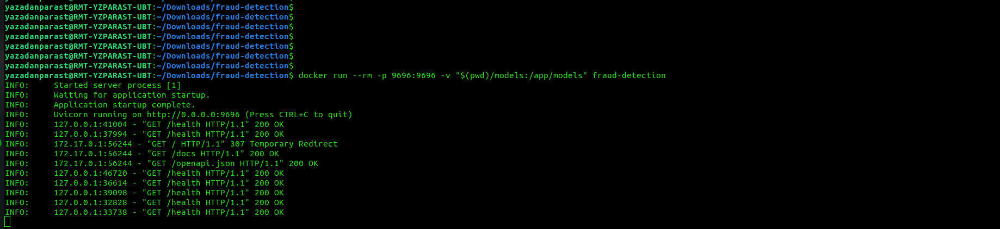

`docker run` with the model mounted. The log shows the healthcheck polling
`/health` (200 OK) and a real browser request: `GET /` → **307 Temporary
Redirect** → `GET /docs` → 200 — the root redirect working inside the container.

---

## 7b. Running the UI in Docker

`Dockerfile` serves only the API, by design: the UI holds no model and talks to
the API over HTTP, so it is a **separate image**. That means the API can be
restarted or scaled without touching the UI, and the UI image never needs the
trained model.

To run both, use `docker-compose.yml`, which builds `Dockerfile` (api) and
`Dockerfile.ui` (ui) and wires them together:

```bash
docker compose up --build
```

| service | URL | image | contains |
|---|---|---|---|
| `api` | http://localhost:9696/docs | `fraud-detection-api` | model + inference |
| `ui` | http://localhost:8501 | `fraud-detection-ui` | Streamlit only |

The compose file sets `API_URL=http://api:9696` on the UI service, so the UI
finds the API by service name on the shared network, and waits for the API's
healthcheck to pass before starting.

### Both containers running

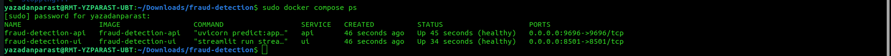

`docker compose ps` after `sudo -E docker compose up --build` — **both services
`Up` and `healthy`**, API on `0.0.0.0:9696->9696/tcp` and UI on
`0.0.0.0:8501->8501/tcp`. Each has a working healthcheck: `/health` for the API,
`/_stcore/health` for Streamlit.

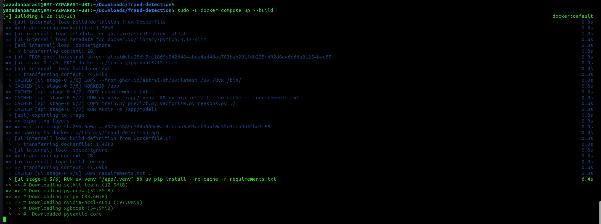

The build: the API image is fully cached, then the UI image is built from
`Dockerfile.ui`.

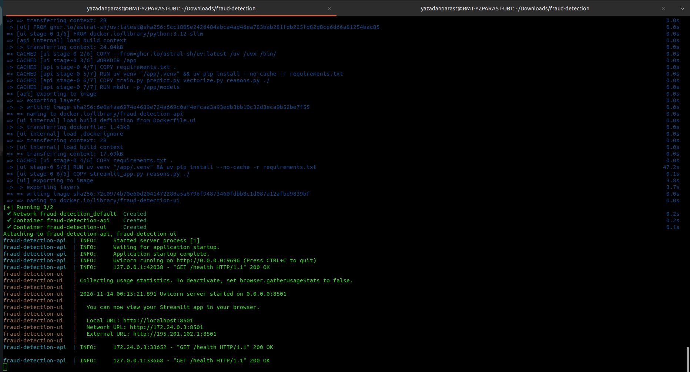

The UI's dependency layer installing — the exact step that fails with
`error resolving DNS` if the proxy variables are not forwarded into the build.

Individual commands, if you prefer:

```bash
docker build -f Dockerfile.ui -t fraud-detection-ui .
docker run --rm -p 8501:8501 -e API_URL=http://host.docker.internal:9696 fraud-detection-ui
```

**Do not run this with a bare `sudo`** — `sudo` strips your environment by
default, so the proxy variables the compose file forwards arrive empty and the
build fails with `error resolving DNS`. Either preserve the environment:

```bash
sudo -E docker compose up --build
```

or, better, drop `sudo` for Docker entirely (one-time setup, then log out and
back in):

```bash
sudo usermod -aG docker $USER
docker compose up --build
```

> As an alternative to shell variables, compose reads a `.env` file from the
> project directory automatically — put `HTTP_PROXY=...` and `HTTPS_PROXY=...`
> there and it works under `sudo` too.

The compose file builds on the host network and forwards your proxy variables as
build args (Docker's predefined proxy args are not baked into the image). With
no proxy set the args are empty and ignored.

---

## 7c. Deploying to Streamlit Community Cloud

The UI is deployed at **Streamlit Community Cloud** (free). There is one
wrinkle worth understanding first.

### Why the app can run without a backend

Locally the UI calls the FastAPI service on port 9696. Streamlit Community
Cloud gives you **one container** — there is no second process to host the API,
so `localhost:9696` does not exist there.

So the UI has a fallback: if no API is reachable it loads the model directly
and scores **in-process**, using `inference.py` — the same module the API uses.
Both paths produce identical output; verified against the sample file, both
return **38 flagged, precision 1.000, recall 0.950**.

| deployment | how it scores |
|---|---|
| local / Docker Compose | HTTP → FastAPI on port 9696 |
| Streamlit Community Cloud | in-process via `inference.py` |

The sidebar tells you which one is live.

### Step 1 · Push to a public GitHub repo

The free tier requires a **public** repository.

#### 1a · Create the repo — leave every checkbox unticked

Go to **https://github.com/new**, name it `fraud-detection`, set visibility to
**Public**, and leave *Add a README file*, *Add .gitignore* and *Choose a
license* **all unticked**.

Starting from a genuinely empty repo avoids the "unrelated histories" rejection
on your first push, and stops GitHub's generic `.gitignore` from colliding with
the project's own one.

#### 1b · Set up SSH (one time)

GitHub has not accepted account passwords over HTTPS since 2021. Pushing over
HTTPS fails with:

```
remote: Invalid username or token. Password authentication is not supported for Git operations.
```

The fix is an SSH key (or a Personal Access Token). SSH is less fiddly — it
does not expire.

```bash
ssh-keygen -t ed25519 -C "your-github-username"     # press Enter 3x
eval "$(ssh-agent -s)" && ssh-add ~/.ssh/id_ed25519
cat ~/.ssh/id_ed25519.pub
```

Copy that output → **https://github.com/settings/keys** → **New SSH key** →
paste → save. Then confirm it works:

```bash
ssh -T git@github.com
# expect: "Hi <username>! You've successfully authenticated, but GitHub does
#          not provide shell access."
```

<details>
<summary>Prefer HTTPS / a Personal Access Token?</summary>

**https://github.com/settings/tokens** → **Generate new token** → *Fine-grained*
→ repository access: `fraud-detection` → permissions: **Contents: Read and
write** → generate. Then, when git asks for a password, paste the **token**, not
your account password.

Or install the GitHub CLI, which handles storing it:

```bash
sudo apt install gh && gh auth login
```

</details>

#### 1c · Point the project at the repo

```bash
cd fraud-detection
git init                     # skip if it is already a git repo
git remote add origin git@github.com:<you>/fraud-detection.git
```

Already cloned over HTTPS? Switch it to SSH:

```bash
git remote set-url origin git@github.com:<you>/fraud-detection.git
```

#### 1d · Commit — the model must be in it

```bash
git add -A
git add -f models/fraud_model.bin     # -f overrides any stale ignore rule
git status --short                    # models/fraud_model.bin MUST appear
git commit -m "PaySim fraud detection: CRISP-DM pipeline, FastAPI + Streamlit, Docker, cloud-ready"
```

If any `data/` or `outputs/` line shows up in `git status`, fix `.gitignore`
before committing.

#### 1e · Push

```bash
git push -u origin main
```

> **If you ticked a README, .gitignore or licence when creating the repo**, the
> first push is rejected as unrelated histories. Force-pushing is the clean fix
> here — and *only* here, because the remote contains nothing but GitHub's
> template files:
>
> ```bash
> git push -f origin main
> ```
>
> A plain `git pull --rebase` also works, but it will overwrite the project's
> `.gitignore` with GitHub's generic one, so prefer the force-push in this
> specific case.

#### 1f · Confirm

```bash
git ls-remote --heads origin
```

Then refresh the repo page: you should see ~44 files, including `inference.py`,
the slim `requirements.txt` and `models/fraud_model.bin`.

`data/` (471 MB dataset) and `outputs/` (10 MB report) are gitignored, so the
push stays small. `models/fraud_model.bin` **is** committed — only 3.7 KB, and
the cloud needs it to score in-process.

### Step 2 · Create the app

1. Go to **https://share.streamlit.io** and sign in with GitHub.
2. **New app** → pick your repo, branch (`main`), and set
   **Main file path** to `streamlit_app.py`.
3. Open **Advanced settings** and set **Python version** → `3.12`.
4. **Deploy**.

> ⚠️ **There is no "Requirements file" setting.** Community Cloud always
> installs the `requirements.txt` at the repository root — you cannot point it
> at a differently-named file. That is why the root `requirements.txt` in this
> repo is the slim cloud set, and the full set lives in `requirements-dev.txt`.
> Leave the **Secrets** box empty: this app needs no secrets. Putting anything
> that is not TOML in there (a filename, a list of packages) produces
> *"Invalid format: please enter valid TOML."* and blocks the save.

### Step 3 · Confirm it came up without the backend

You should see the amber **"no backend — running the model in-process"**
message in the sidebar instead of the green "backend online". That is the
expected state in the cloud, not an error.

Then check it works:

* Single transaction → **🔴 Fraudulent transfer** → 🚫 BLOCK, probability 1.0000
* **📂 Batch file** → upload `sample_transactions.csv` → 38 fraud found,
  precision 1.000

### Notes

* The root `requirements.txt` is deliberately slim: no fastapi, uvicorn,
  xgboost or pyarrow. Community Cloud installs that file, and the heavier set
  is slow enough to time out the free-tier build. None of it is needed
  in-process — see `requirements-dev.txt` for the full local/Docker set.
* Cloud storage is ephemeral — anything the app writes is lost when it sleeps.
  The app only reads, so this does not affect it.
* To redeploy after a change: push to GitHub; the app rebuilds automatically.
* Prefer the API-backed architecture in the cloud? You would need a second
  host (Render, Fly.io, Railway) for the API and to set `API_URL` to it in the
  app's secrets. That is more moving parts than this project needs.

---

## 8. Project structure

```
├── README.md
├── notebook.ipynb          EDA, feature importance, model selection
├── train.py                training pipeline -> models/fraud_model.bin
├── predict.py              FastAPI web service
├── streamlit_app.py        Streamlit UI (calls the API, holds no model)
├── score_and_export.py     tree + Isolation Forest scoring -> Excel report
├── reasons.py              shared reason codes + upload column detection
├── vectorize.py            memory-bounded DictVectorizer transform
├── sample_transactions.csv 200-row demo file to try batch upload
├── pyproject.toml          dependency source of truth
├── uv.lock                 frozen transitive tree (53 packages)
├── requirements.txt        slim deps - what Streamlit Cloud installs
├── requirements-dev.txt    full deps - local pip fallback + Docker image
├── inference.py            shared scoring logic (no web framework)
├── Dockerfile              API service image
├── Dockerfile.ui           Streamlit UI image
├── .streamlit/config.toml  cloud theme settings
├── docker-compose.yml      runs both with `docker compose up`
├── data/                   dataset (downloaded, not committed)
│   ├── paysim.csv
│   └── paysim_model.parquet   prepared-table cache
├── models/
│   └── fraud_model.bin     trained artefact
├── outputs/
│   └── fraud_report.xlsx   flagged transactions + reason codes
├── images/                 screenshots used in section 10
└── sample_transactions.csv
```

---

## 9. Limitations

- **Synthetic data.** PaySim is a simulator calibrated on one operator in one
  country. The account-draining signature is likely an artifact of how fraud was
  injected — the ~99.7% PR-AUC should be read as "the injected rule is easy to
  detect", **not** as a realistic production number. Real fraud detection lives
  in the 0.5–0.9 PR-AUC range.
- **No account history.** Payers are effectively unique (6.35M distinct payers
  in 6.36M rows), so velocity and behavioural features — the backbone of
  production fraud systems — cannot be built.
- **The threshold is not cost-optimised.** The F1-optimal threshold is reported
  for reference. A real deployment would set it from the actual cost of a false
  positive versus a false negative, which varies by operator and is not in the
  dataset.
- **No drift handling.** Fraud patterns shift; a deployed model needs monitoring
  and a retraining cadence, neither of which is implemented here.

---

---

## 10. Screenshots

### Project files

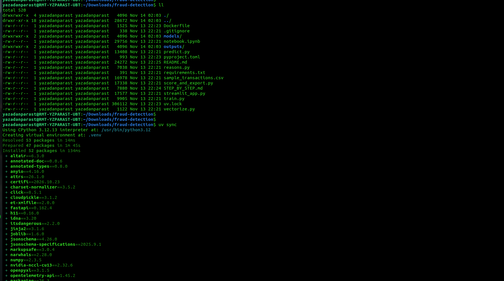

The project as it lands after unzipping. `models/fraud_model.bin` ships with the
zip, so the service runs immediately — no training or dataset download needed.

### Installing dependencies with uv

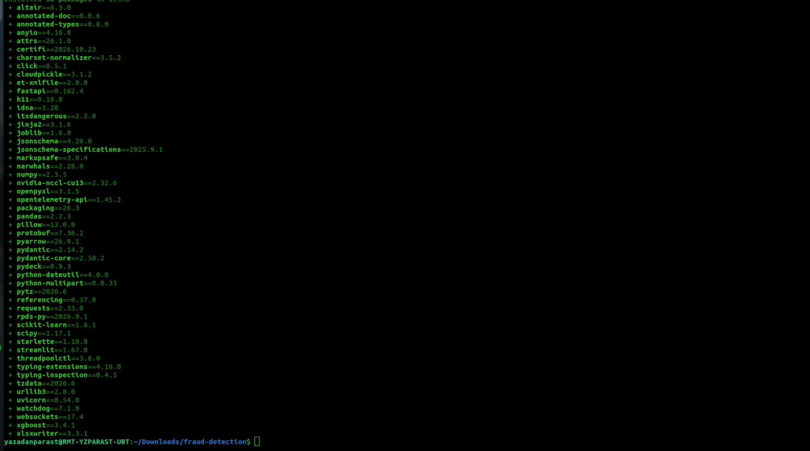

`uv sync` creates `.venv` and installs the exact versions recorded in
`uv.lock` — 53 packages, including the transitive tree. No `pip`, no manual
activation step.

### Starting the API

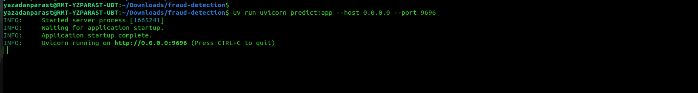

`uv run uvicorn predict:app --host 0.0.0.0 --port 9696`. `uv run` enters the
project environment created by `uv sync`, so there is no activation step.

### Interactive API documentation

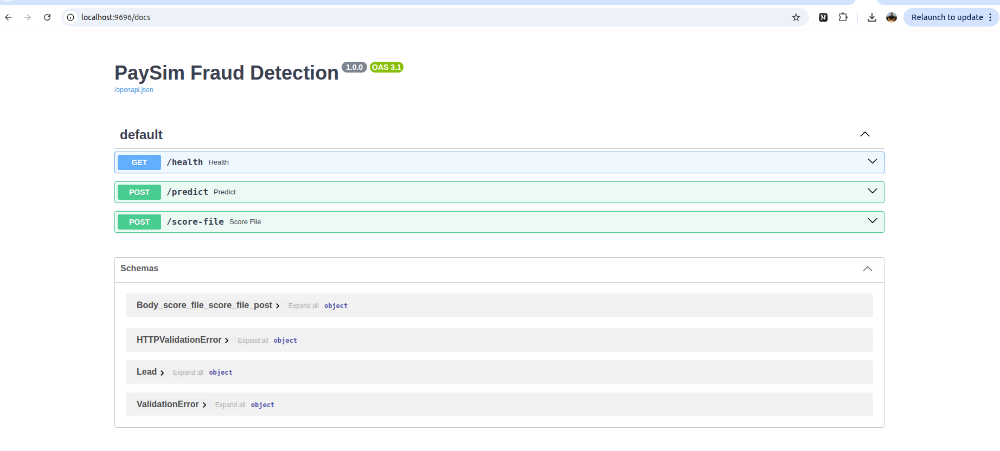

`http://localhost:9696/docs` — FastAPI generates this from the code. The three
endpoints are `/health` (service and model metadata), `/predict` (score one
transaction) and `/score-file` (score an uploaded CSV/Excel).

Opening the bare root `http://localhost:9696` redirects here rather than
returning a 404.

### The deployed model answering requests

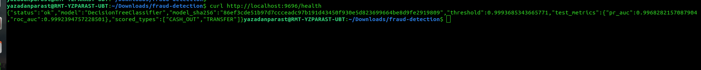

`curl http://localhost:9696/health` against the running service returns the
loaded model and the metrics it was selected on — PR-AUC **0.9968**,
ROC-AUC **0.9992** — plus the decision threshold and the transaction types the
model scores. The `model_sha256` identifies the exact artefact being served.

### Starting the web UI

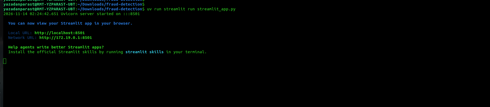

`uv run streamlit run streamlit_app.py` — Streamlit starts on port 8501 and
connects to the API on 9696. The UI holds no model of its own.

### Flagging a fraudulent transfer

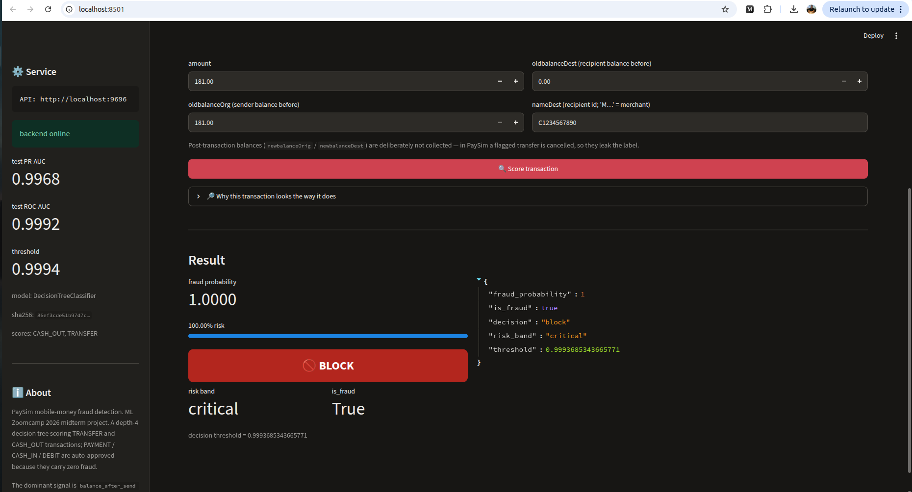

The **🔴 Fraudulent transfer** preset: a TRANSFER of 181.00 from an account
holding exactly 181.00. Probability **1.0000**, risk band `critical`, verdict
**🚫 BLOCK**. The sidebar confirms the backend is online and shows the test
metrics of the model actually serving the request.

### Why it was flagged

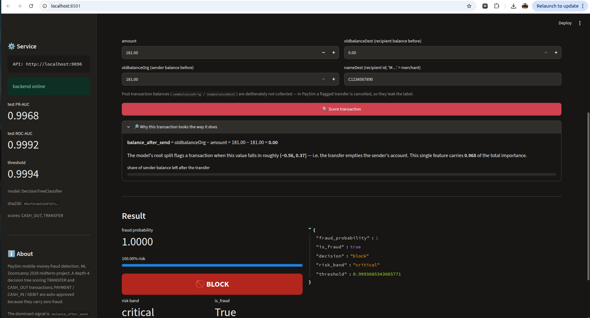

The UI shows its working: `balance_after_send = oldbalanceOrg − amount`
= 181.00 − 181.00 = **0.00**. The transfer empties the sender's account, which
is the signature the tree keys on (0.968 of total importance).

### Clearing a legitimate transfer

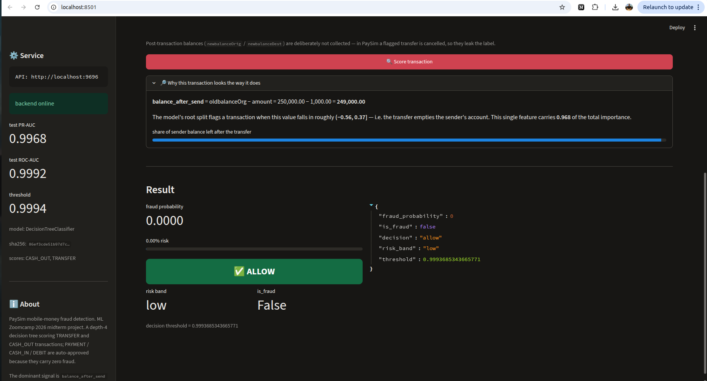

The **🟢 Legitimate transfer** preset sends 1,000.00 from a balance of
250,000.00, leaving 249,000.00 behind. Probability **0.0000**, verdict
**✅ ALLOW** — the model is not simply flagging large amounts.

### Auto-approving a transaction type with no fraud

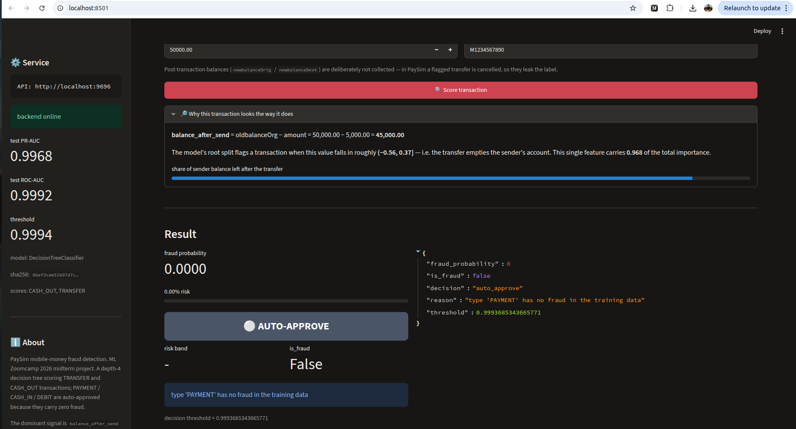

A PAYMENT is not scored at all. PAYMENT, CASH_IN and DEBIT contain exactly zero
fraud in the training data, so the service auto-approves them rather than
spending a prediction on them.

### Scoring an uploaded file

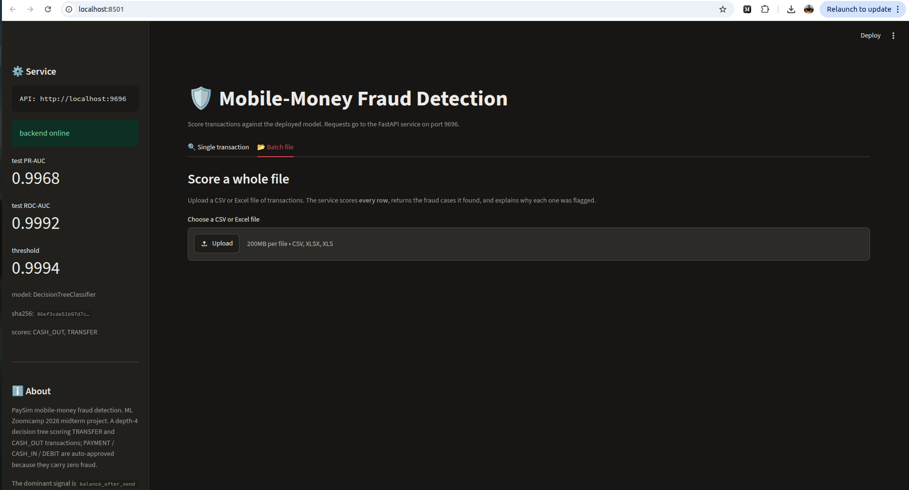

The **📂 Batch file** tab accepts CSV or Excel, detects the columns
automatically and scores every row — returning the fraud cases with a reason
for each, and precision/recall if the upload carries ground-truth labels.

### ...loading the file

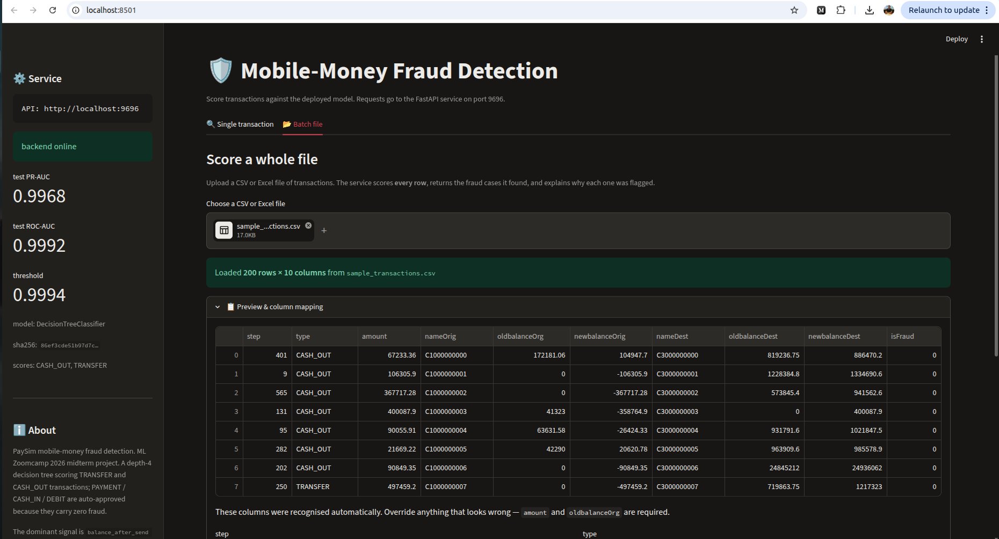

Uploading `sample_transactions.csv` — 200 rows, 10 columns. The preview panel
opens immediately so you can check the file before scoring it.

### ...columns recognised automatically

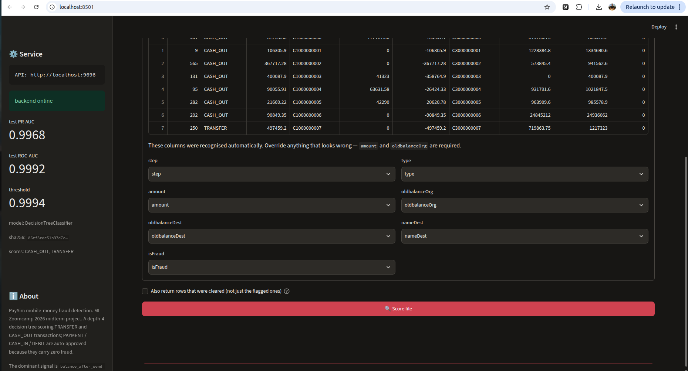

Every column is matched without help, including the post-transaction balances
— which the service then deliberately ignores. Anything mis-detected can be
remapped by hand from this panel.

### ...the report

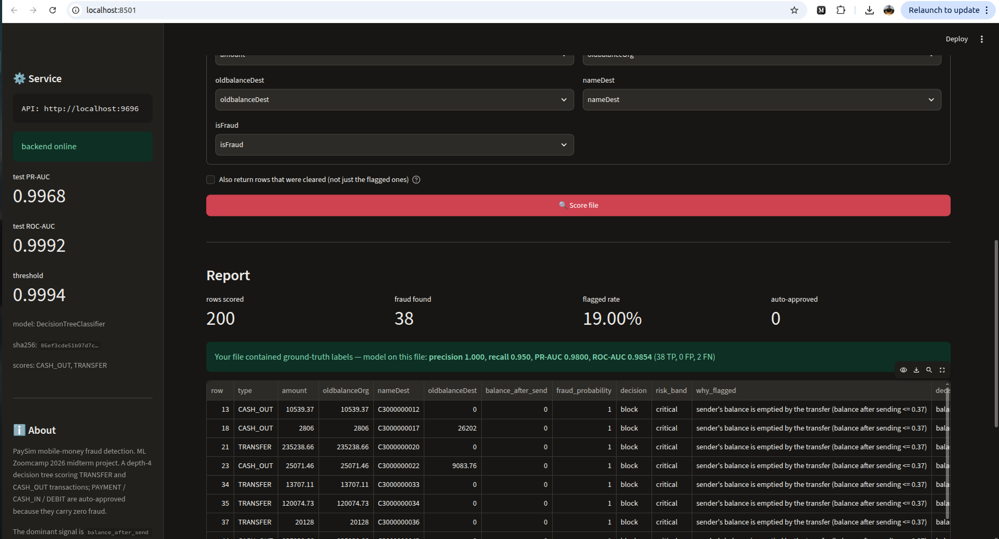

The scored result: **200 rows scored, 38 fraud found, 19.00% flagged rate,
0 auto-approved**. Because the upload carried ground-truth labels, the service
also scores itself on your data: **precision 1.000, recall 0.950,
PR-AUC 0.9800, ROC-AUC 0.9854 (38 TP, 0 FP, 2 FN)**.

### ...why each row was flagged

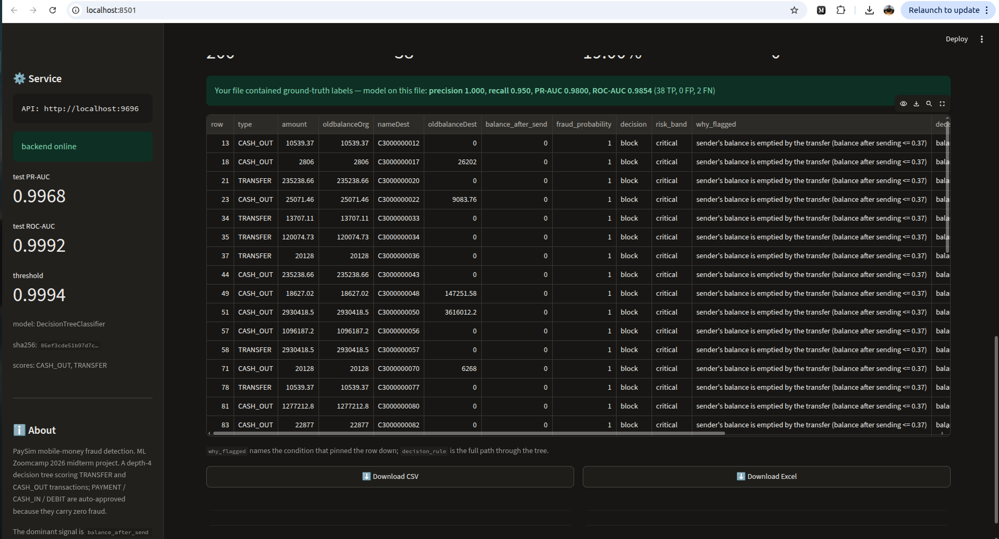

Every row carries `why_flagged` — here *"sender's balance is emptied by the
transfer"* — plus `fraud_probability`, `decision` and `risk_band`.

### ...the exact decision path

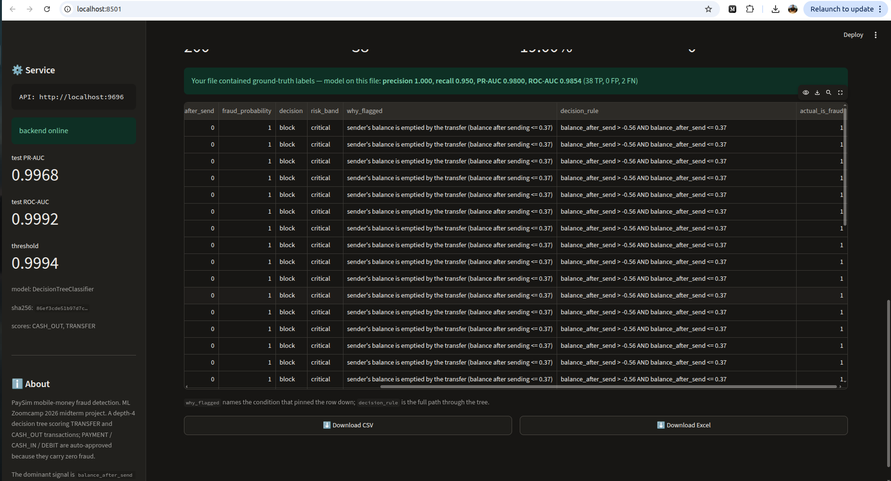

`decision_rule` is the full path through the tree:
`balance_after_send > -0.56 AND balance_after_send <= 0.37`.
`actual_is_fraud` is shown alongside because the upload had labels.

### ...downloading as CSV

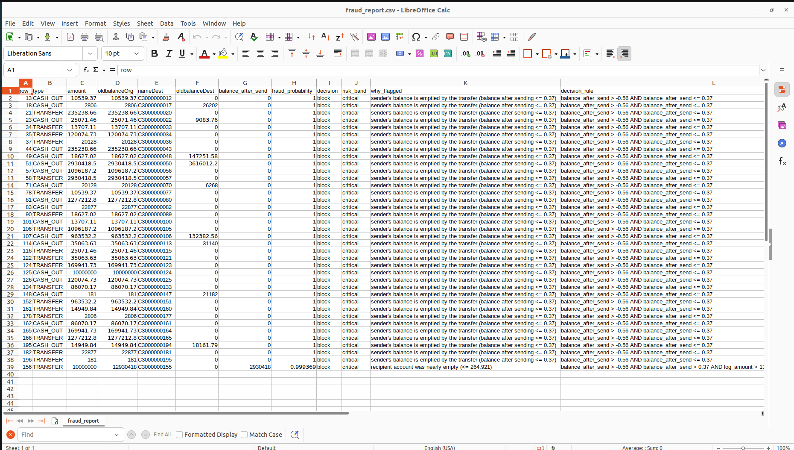

The report opens in any spreadsheet — here LibreOffice Calc — with the reason
columns intact.

### ...downloading as Excel

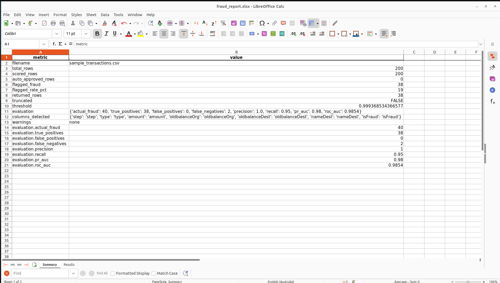

The Excel export adds a **Summary** sheet: rows scored, fraud found, the
detected column mapping, and the full evaluation dictionary.

### Building the container

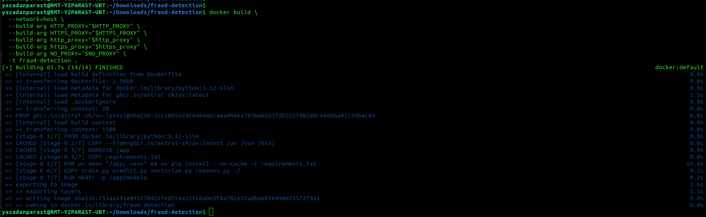

`docker build` finishing: all 7 layers built, 52 packages installed by uv inside
the image, tagged `fraud-detection`. The image is `python:3.12-slim` and does
not contain the model — that is mounted at run time.

---

## 11. CRISP-DM

| Phase | Where |
|---|---|
| Business understanding | §1 — asymmetric cost of false positives vs negatives |
| Data understanding | §3, `notebook.ipynb` — 6.36M rows, imbalance, time structure |
| Data preparation | §4 — type filter, leak-free feature policy, 11 engineered features |
| Modeling | §5 — 4 model families, 15 configurations, tuned on validation |
| Evaluation | §5 — held-out test: PR-AUC 0.9968, 7 FP / 4 FN |
| Deployment | §6–7 — FastAPI service + Docker, health endpoint reports metrics |
